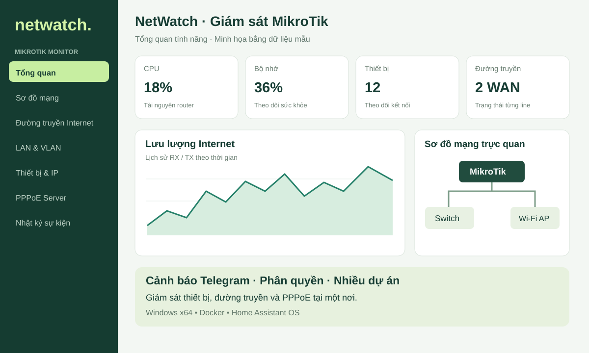
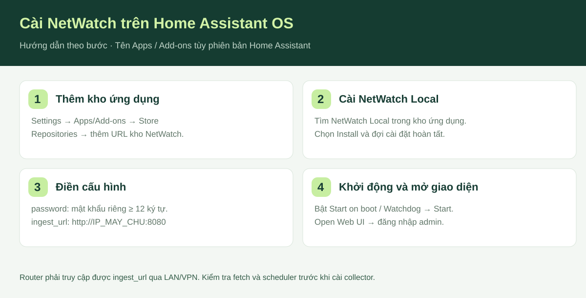
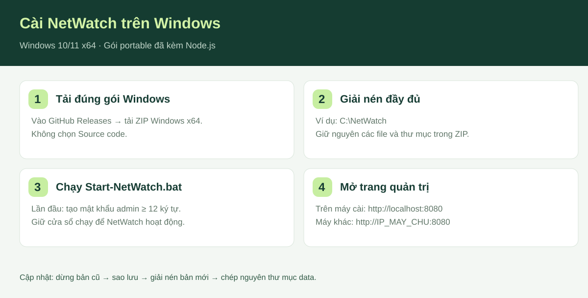

# NetWatch · Giám sát MikroTik

Chạy trên Windows, Linux, macOS hoặc Home Assistant OS, lưu dữ liệu tại máy chủ NetWatch.
Sơ đồ mạng kéo thả, ghim/alias, switch ảo, chỉnh neo/đường dây, nhiều dự án MikroTik,
DHCP/PPPoE và lịch sử lưu cục bộ trong `/data`.

*Hình minh họa tính năng bằng dữ liệu mẫu, không phải ảnh chụp một hệ thống đang vận hành.*

- Theo dõi tài nguyên MikroTik, WAN, LAN/VLAN, thiết bị và PPPoE.
- Sơ đồ kéo thả, ghim thiết bị và theo dõi IP quan trọng.
- Cảnh báo Telegram khi có sự cố, nhắc lại theo cấu hình.
- Nhiều dự án, tài khoản chỉ xem và dữ liệu lưu tại máy chủ của bạn.

**[Tải gói Windows x64](https://github.com/phuongtrangpt/netwatch/releases/latest)** · **[Hướng dẫn cài và cấu hình](netwatch/DOCS.md)**

[Thêm kho NetWatch vào Home Assistant](https://my.home-assistant.io/redirect/supervisor_add_addon_repository/?repository_url=https%3A%2F%2Fgithub.com%2Fphuongtrangpt%2Fnetwatch)

## Cài online trên Home Assistant OS

1. Chờ workflow trong tab **Actions** hoàn tất thành công.
2. Chỉ ở lần đầu, chủ kho mở package **netwatch** trên GitHub → Package settings →
   Change visibility → **Public**. Repository public không tự làm package GHCR public.
3. Home Assistant → Settings → Apps/Add-ons → Store → ⋮ → Repositories.
4. Thêm `https://github.com/phuongtrangpt/netwatch`.
5. Tìm **NetWatch Local**, chọn Install. Điền password và ingest_url, Start, Open Web UI.

[Hướng dẫn cấu hình](netwatch/DOCS.md). Nếu chưa thấy image hoặc ghcr.io trả Unauthorized,
kiểm tra workflow và trạng thái Public của package trước; chưa cần thay cấu hình router.

## Cập nhật sau này

- Sửa mã và chạy `npm run build`, `npm test`.
- Tăng cùng một phiên bản (ví dụ 1.0.1) ở `package.json`, `package-lock.json` và
  `netwatch/config.yaml`; thêm nội dung vào `netwatch/CHANGELOG.md`.
- Đẩy thay đổi lên `main`. Workflow tự kiểm tra và build/push image mang số phiên bản mới.
- Đợi Actions xanh, Home Assistant kiểm tra cập nhật kho. Backup NetWatch rồi chọn Update.
- Dữ liệu riêng trong `/data` được giữ lại. Không gỡ/cài lại add-on để cập nhật.

Nếu sửa mã mà chưa tăng phiên bản, workflow chỉ kiểm tra, không đẩy đè image phiên bản cũ.
Mỗi lần tăng phiên bản trên main, workflow kiểm tra, đẩy image đa kiến trúc và tạo GitHub Release có gói Windows. Có thể chạy lại qua Actions → Kiểm tra và phát hành NetWatch → Run workflow trên main.

Không cần Docker Hub hoặc token cá nhân cho workflow: GHCR dùng GITHUB_TOKEN với quyền
packages:write. Không commit `.env`, database, khóa router hoặc dữ liệu xuất từ web cũ.

## Cài trên Windows, macOS, Linux và Home Assistant OS (1.0.10)

- **Windows 10/11 x64, không cần cài Docker hoặc Node.js:** tải `netwatch-windows-x64-1.0.10.zip` tại [GitHub Releases](https://github.com/phuongtrangpt/netwatch/releases/latest), giải nén rồi mở `Start-NetWatch.bat`. Lần đầu tạo mật khẩu Admin; dữ liệu lưu trong thư mục `data` cạnh ứng dụng.
- **Windows có Docker Desktop, macOS có Docker Desktop, Linux có Docker Engine:** dùng image `ghcr.io/phuongtrangpt/netwatch:1.0.10` hoặc `compose.yaml`.
- Image Docker có `linux/amd64` cho PC/server x86-64, `linux/arm64` cho Apple Silicon và máy chủ ARM64, `linux/arm/v7` cho hệ ARM32 tương thích. Windows/macOS Docker Desktop chạy image Linux trong máy ảo Docker.
- **Home Assistant OS:** tiếp tục cài add-on theo hướng dẫn hiện tại; máy chủ aarch64 tự nhận image ARM64.

Bản Windows portable x64 được kiểm tra khởi động trên Windows CI. Gói này không dành cho Windows ARM. Với máy Mac hoặc Linux, dùng Docker để tự chọn kiến trúc và giữ dữ liệu trong named volume.

## Kiến trúc và kiểm tra

Image: `ghcr.io/phuongtrangpt/netwatch:1.0.10`, gồm `linux/amd64`, `linux/arm64` và `linux/arm/v7`.
Chọn kiến trúc theo phần cứng máy chủ: x86-64, ARM64 hoặc ARMv7.
Docker image dùng Node.js 22 LTS Alpine vì hỗ trợ đồng thời amd64, ARM64 và ARMv7. Gói Windows portable dùng Node.js 24 LTS. Hai cách cài dùng cùng mã ứng dụng; dữ liệu lưu riêng trong từng cài đặt.

CI chạy kiểm tra mã, smoke test gói Windows, và khởi động thử ARM64/ARMv7 bằng QEMU; thử trên máy chủ thật vẫn cần thiết.
Đây là bản ứng dụng độc lập, không tự đồng bộ dữ liệu với web NetWatch trên cloud.

[Docker, backup và chuyển dữ liệu](docs/DOCKER.md)

## Phân quyền Viewer và banner hỗ trợ (từ 1.0.3)

- Admin mở **Cấu hình giám sát → Quản lý tài khoản xem** để tạo nhiều Viewer. Mỗi tài khoản chọn dự án và từng mục được phép xem (Tổng quan, Sơ đồ mạng, WAN, LAN, Thiết bị, Cổng, Định tuyến, PPPoE, Sự kiện).
- Các dự án và mục không được cấp quyền bị ẩn trên giao diện **và bị chặn ở API**. Viewer không tạo khóa router, thay đổi sơ đồ hoặc chỉnh cấu hình.
- Admin mở **Cấu hình giám sát → Banner hỗ trợ kỹ thuật** để chỉnh tên KTV, số điện thoại, Facebook, nội dung, vị trí trên/dưới và hiển thị cho mọi người hoặc chỉ Viewer.
- Trang đăng nhập responsive có thông tin sử dụng miễn phí, số điện thoại và link Facebook hỗ trợ.
- Đăng nhập qua HTTPS reverse proxy được hỗ trợ thông qua Fetch Metadata của trình duyệt; với proxy đặc biệt có thể cấu hình `NETWATCH_PUBLIC_URL`, hoặc `NETWATCH_ALLOWED_ORIGINS` là danh sách origin được phép, cách nhau dấu phẩy. Chỉ bật `NETWATCH_TRUST_PROXY=true` nếu máy chủ đứng sau proxy đáng tin cậy đã ghi đè các header `X-Forwarded-Host` và `X-Forwarded-Proto`.
- Nâng cấp giữ dữ liệu cũ trong `/data`. Tài khoản Viewer cũ vẫn hoạt động và ban đầu giữ quyền xem mọi dự án, mọi mục cho tương thích; hãy vào Admin chỉnh lại phạm vi trước khi chia sẻ.
- Trước khi cập nhật Add-on, tạo bản backup dữ liệu. Không chia sẻ `/data` hoặc token thu thập router.

## Cập nhật Windows portable, giữ nguyên dữ liệu

1. Dừng bản đang chạy bằng **Ctrl+C**, sao lưu toàn bộ thư mục NetWatch cũ.
2. Tải ZIP **Windows x64** ở [Releases](https://github.com/phuongtrangpt/netwatch/releases/latest), giải nén vào thư mục mới (không chọn Source code).
3. Chép nguyên thư mục `data` cũ sang thư mục mới, cạnh `Start-NetWatch.bat`. Giữ lại tùy chỉnh cổng/URL hoặc script khởi động nếu có; giữ IP và cổng cũ để router tiếp tục gửi dữ liệu.
4. Chạy `Start-NetWatch.bat` trong thư mục mới. Nếu được hỏi tạo mật khẩu mới, dừng và kiểm tra `data/auth.json` đã được chép đúng chưa.
5. Mở địa chỉ cũ, nhấn **Ctrl+F5**, đăng nhập và kiểm tra dự án, sơ đồ, dữ liệu router.

Không cần cài lại collector trên MikroTik khi giữ nguyên dữ liệu, địa chỉ và cổng. Để quay lại bản cũ, dừng bản mới rồi dùng bản sao dữ liệu trước cập nhật với bản cũ.

## Cảnh báo Telegram (1.0.10)

- Trong **Cấu hình giám sát**, bật **Tự chọn interface WAN**, chọn đúng interface cho từng line và lưu. Dự án chỉ bật kiểm tra Internet riêng khi có ít nhất hai interface được chọn; PPPoE chọn interface PPPoE client.
- Collector ping `8.8.8.8` qua từng interface đã chọn, hai gói mỗi chu kỳ. NetWatch chỉ xác nhận line offline sau hai chu kỳ liên tiếp thất bại. Trạng thái Link và Internet được hiển thị riêng.
- Tại **Cảnh báo sự cố qua Telegram** của dự án Mạng chính, cấu hình Bot Token và Chat ID cá nhân dùng làm kênh tổng. Kênh này nhận sự cố của tất cả dự án. Token được mã hóa và dùng chung.
- Trong từng dự án, có thể bật Chat ID nhóm riêng. Nhóm chỉ nhận sự cố từ dự án đó; thêm bot vào nhóm và cấp quyền gửi tin nhắn. Không dùng chung Chat ID nhóm nếu muốn tách riêng người nhận.
- Khi thêm/chỉnh sửa IP trên sơ đồ, bật **Cho router ping định kỳ IP này** và tích **Thông báo Telegram khi thiết bị gặp sự cố**. Chọn gửi một lần (vẫn gửi khi phục hồi), lặp lại mỗi 30 phút hoặc mỗi giờ. NetWatch báo Offline sau hai chu kỳ liên tiếp không phản hồi; lỗi ping không kết luận thiết bị Offline.
- Bản tin sáng mặc định gửi 08:00 giờ Việt Nam tới kênh tổng, gồm trạng thái từng dự án, thiết bị/line đang Offline và cảnh báo ghi nhận trong 24 giờ. Admin có thể đổi giờ hoặc tắt trong cấu hình kênh tổng.
- Nhắn `/start` cho bot cá nhân, lưu cấu hình rồi bấm **Gửi thử**. Để thử nhóm, lưu Bot Token ở Mạng chính, thêm bot vào nhóm, nhập Chat ID nhóm và gửi thử.
- Với cấu hình cũ từ 1.0.5, NetWatch tự dùng Chat ID/Token hiện có làm kênh Admin khi bạn lưu cấu hình mới; Chat ID nhóm cần nhập riêng trong từng dự án.
- Bot Token được mã hóa bằng khóa riêng nằm trong `/data/auth.json`; không hiển thị lại trong giao diện và không cấp cho Viewer. Sao lưu `/data` để giữ khóa giải mã khi di chuyển máy.
- Router đã cài collector cũ cần một lần tải **nâng cấp v5 giữ nguyên khóa** trong mục Kết nối router, upload `.rsc` vào WinBox Files rồi chạy `/import file-name=netwatch-upgrade-v5.rsc`. Router mới dùng bộ cài v5. Không sửa routing table hoặc cấu hình WAN.

## Quyền router trước khi kết nối

KTV kiểm tra `fetch` và `scheduler` trong device-mode. Nếu bị tắt, bật bằng `/system device-mode update fetch=yes scheduler=yes` và xác nhận vật lý theo hướng dẫn tại **Kết nối router** hoặc [hướng dẫn chi tiết](netwatch/DOCS.md#ktv-bật-fetch-và-scheduler-trước-khi-cài-collector). Router sẽ khởi động lại; không cần đổi toàn bộ mode.

## Theo dõi lượt tải và lượt truy cập GitHub

- Huy hiệu **Lượt tải** ở đầu README tự cập nhật tổng số lần tải các file đính kèm trong GitHub Releases. Đây là **lượt tải**, không phải số người dùng riêng biệt hoặc số bản cài đang hoạt động. Không bao gồm ZIP Source code hoặc lượt kéo image Docker/GHCR.
- Xem từng file bằng [GitHub Releases API](https://api.github.com/repos/phuongtrangpt/netwatch/releases?per_page=100), trường `assets[].download_count`. API phân trang nếu có nhiều hơn 100 bản phát hành.
- Chủ kho có thể mở [Insights → Traffic](https://github.com/phuongtrangpt/netwatch/graphs/traffic) để xem lượt xem, khách truy cập và lượt clone trong 14 ngày gần nhất. Clone không đồng nghĩa đã cài NetWatch.
- Tài liệu: [Release assets](https://docs.github.com/en/repositories/releasing-projects-on-github/about-releases), [Repository traffic](https://docs.github.com/en/repositories/viewing-activity-and-data-for-your-repository/viewing-traffic-to-a-repository).
